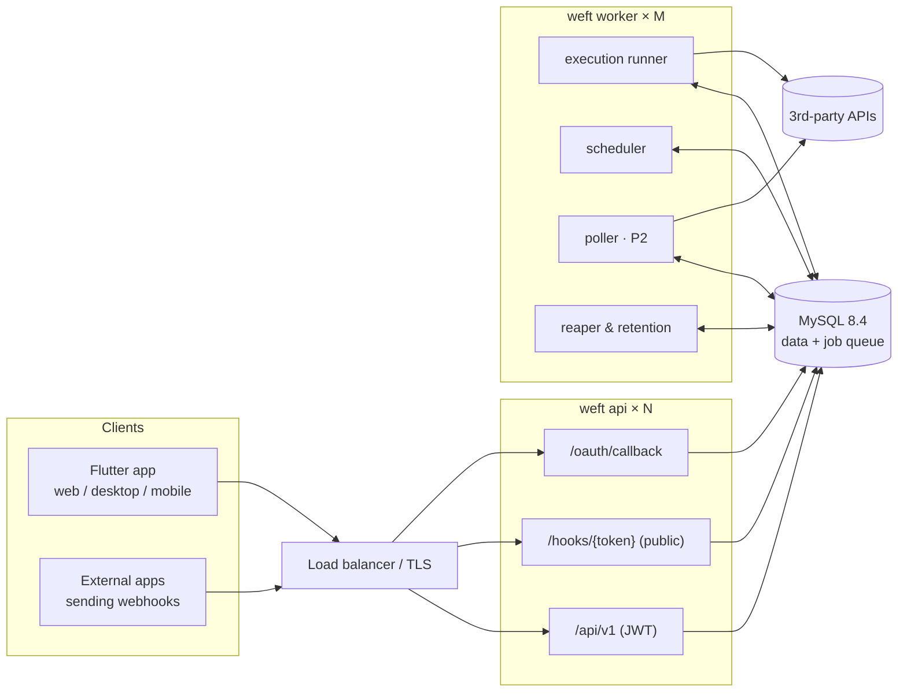
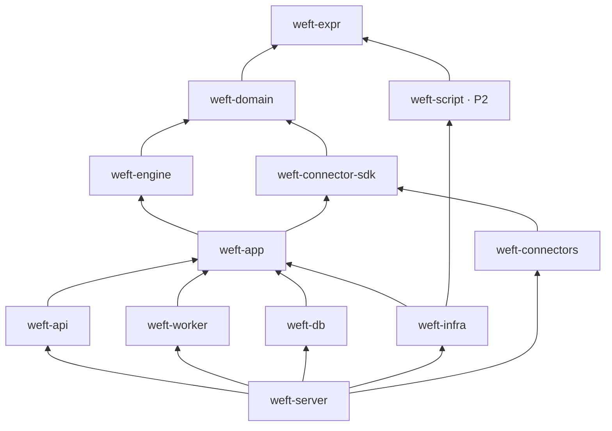
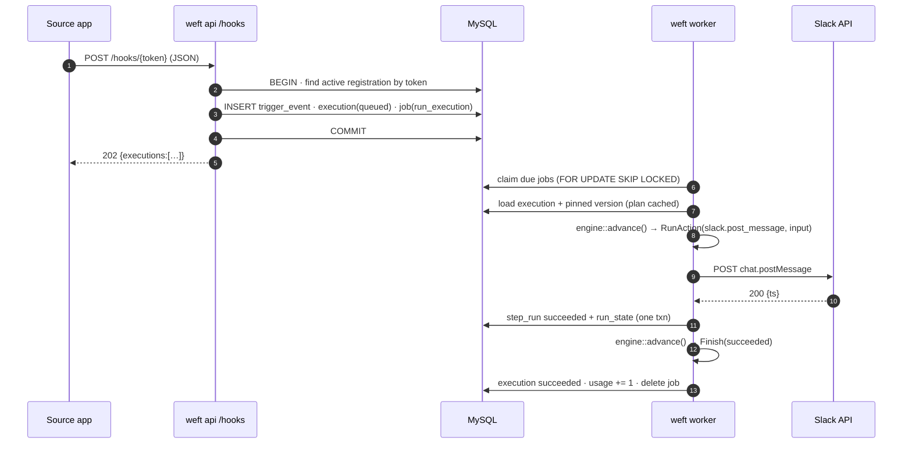
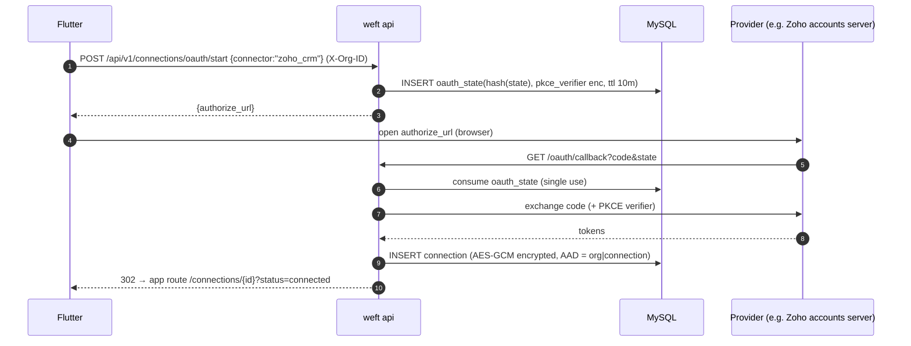

# 02: Architecture

## 1. Style in one paragraph

Weft is a **modular monolith** built as a **Cargo workspace**. Inside it we use **hexagonal architecture** (ports and adapters) with a **functional core and an imperative shell**:
- The business rules (`domain`), the expression language (`expr`) and the workflow interpreter (`engine`) are **pure crates**: no async, no IO, no clock, no randomness.
- Use cases (`app`) orchestrate those crates through **port traits**.
- Adapters (`db`, `infra`, `connectors`) implement the ports.
- Delivery mechanisms (`api` for HTTP, `worker` for background loops) call the use cases.
- One composition root (`server`) wires everything into a single binary that can run as `api`, `worker` or `all`.

Inside `app` and `api`, code is organised into **vertical feature slices with one use case per file**.

### Why not microservices or an external workflow engine?

| Option | Verdict |
|---|---|
| Microservices | Rejected for now. Network boundaries multiply failure modes, local setup is harder, and AI agents lose cross-service context. Crate boundaries give us the same modularity, enforced by the compiler. The worker can still be scaled separately because it is a separate *process role*. |
| Temporal / Restate / Kafka / Redis queues | Rejected for now. The requirement is "Rust and MySQL, that's it", and durable execution for this domain is small enough to own (see [04-workflow-engine.md](04-workflow-engine.md)). The queue sits behind a `JobQueue` port so it can be swapped later. |
| ORM (SeaORM / Diesel) | Rejected. sqlx with compile-time-checked SQL is more transparent, and AI agents write SQL very well. |

---

## 2. Runtime topology



| Process role | Command | Does | Scales by |
|---|---|---|---|
| `api` | `weft api` | REST for the client, webhook ingress, OAuth callback, OpenAPI docs | Adding replicas (stateless) |
| `worker` | `weft worker` | Claims jobs and runs executions, fires schedules, polls (P2), reaps expired leases, sweeps retention | Adding replicas (SKIP LOCKED makes this safe) |
| `all` | `weft all` | Both roles in one process, with an in-process wake-up signal. Used for dev, tests and small self-hosted installs. | — |
| `migrate` | `weft migrate` | Applies pending migrations, then exits. Run as a deploy step. | — |

There is **no leader election**: every background loop claims work with `FOR UPDATE SKIP LOCKED`, so any number of workers can run concurrently.

---

## 3. Repository layout (the `backend` branch)

The repository has two branches with separate histories: `backend` (this layout) and `client` (the Flutter app, see doc 10 §2). The backend publishes the contract files under `openapi/` and `fixtures/`, and the client syncs them (README, "Repository layout").

```
weft/
├── AGENTS.md                     # root rules for AI agents (CLAUDE.md is a symlink to it)
├── justfile                      # every dev command; `just check` == CI
├── rust-toolchain.toml           # pinned toolchain
├── Cargo.toml                    # [workspace]: members, shared dependency versions, lints
├── deny.toml                     # cargo-deny: licenses, bans, advisories, duplicate versions
├── clippy.toml                   # allow-unwrap-in-tests etc.
├── .sqlx/                        # sqlx offline query metadata (generated, committed)
├── migrations/                   # forward-only SQL migrations (append-only)
├── openapi/openapi.json          # generated from code, committed, drift-checked in CI
├── fixtures/flows/*.json         # canonical flow definitions shared by Rust and Dart tests
├── crates/
│   ├── expr/                     # weft-expr          (pure)
│   ├── domain/                   # weft-domain        (pure)
│   ├── engine/                   # weft-engine        (pure)
│   ├── connector-sdk/            # weft-connector-sdk
│   ├── connectors/               # weft-connectors
│   ├── script/                   # weft-script        (pure; Rhai sandbox; added in P2)
│   ├── app/                      # weft-app           (use cases + ports)
│   ├── db/                       # weft-db            (MySQL adapters)
│   ├── infra/                    # weft-infra         (non-DB adapters)
│   ├── api/                      # weft-api           (axum)
│   ├── worker/                   # weft-worker        (background loops)
│   ├── server/                   # weft-server        (bin `weft`: wiring + CLI)
│   └── testkit/                  # weft-testkit       (test-only helpers)
├── xtask/                        # `cargo xtask …`: architecture checks, codegen, custom lints
├── e2e/                          # black-box tests against a running stack
├── deploy/                       # docker-compose.yml, Dockerfile, k8s/ manifests
└── docs/
    ├── plan/                     # this plan
    ├── adr/                      # architecture decision records
    ├── specs/                    # feature specs with acceptance criteria
    ├── recipes/                  # step-by-step "how to add X"
    └── generated/map.md          # inventory generated by `cargo xtask map`
```

---

## 4. Crates, responsibilities and dependency rules

| Crate | Owns | May depend on (internal) | Must never use |
|---|---|---|---|
| `weft-expr` | Template rendering, typed expressions, condition trees, filters | — | tokio, sqlx, reqwest, axum, any IO |
| `weft-domain` | IDs, entities, `FlowDefinition` and its validation, schedule math, the permission matrix, error codes | expr | async, IO crates |
| `weft-engine` | Compiling a definition into a `Plan` (IR); the pure interpreter; retry decisions | domain, expr | async, IO crates |
| `weft-connector-sdk` | `Connector`/`Action`/`Trigger` traits, manifest and field schema, `ConnectorError`, the `HttpSender` trait, test harness helpers | domain | sqlx, axum, app |
| `weft-connectors` | Built-in connectors (native Rust and YAML) and the declarative runtime | connector-sdk, domain, expr, script | sqlx, axum, app |
| `weft-script` (P2) | The Rhai engine for custom functions: sandbox limits, registered helpers, JSON ↔ `Dynamic`, AST cache (doc 08 §7) | expr | tokio, sqlx, reqwest, axum, any IO |
| `weft-app` | Use cases, ports (traits), `Deps`, `Actor`, `AppError`, the execution **runner** that drives the engine | domain, expr, engine, connector-sdk | sqlx, axum, reqwest, lettre |
| `weft-db` | MySQL implementations of the repository ports, the job queue, migration embedding, a `testing` feature with fixtures | app, domain, engine, connector-sdk | axum, reqwest |
| `weft-infra` | Crypto (AES-GCM, per-org HKDF keys), Logto JWT verification (JWKS), mailer (lettre), the SSRF-guarded HTTP sender (reqwest), system clock, ID generator, the pooled `ScriptRunner` (P2, wraps `weft-script`) | app, domain, connector-sdk, script | sqlx, axum |
| `weft-api` | axum router, handlers, DTOs, extractors (auth, pagination, If-Match), the problem+json mapping, OpenAPI | app, domain, connector-sdk | sqlx, db, infra |
| `weft-http` | The reqwest-based `HttpSender` used by connectors | connector-sdk | sqlx, axum |
| `weft-worker` | Job claim loop, scheduler, poller, reaper, retention sweeper, graceful shutdown | app, domain | sqlx, axum |
| `weft-server` | Configuration, the **composition root**, CLI (clap), telemetry setup | everything | — |
| `weft-testkit` | Builders, in-memory fakes, repository contract suites, `ManualClock`, wiremock helpers | domain, expr, engine, connector-sdk, app | db (to avoid dev-dependency cycles) |



**Enforcement:** `cargo xtask check-arch` reads `cargo metadata` and fails CI if any *normal* (non-dev) dependency edge is not in the table above, or if a banned external crate shows up in a pure crate. Agents cannot "just import sqlx in the domain".

---

## 5. Layout inside a crate (vertical slices)

### `weft-app`
```
crates/app/src/
├── lib.rs              # module list + re-exports only; no logic
├── deps.rs             # Deps: every port as Arc<dyn …>
├── actor.rs            # Actor { user_id, org_id, role } + require(Permission)
├── error.rs            # AppError { kind, code, message, fields }
├── ports/              # one trait per file
│   ├── mod.rs
│   ├── clock.rs  id_gen.rs  secret_box.rs  identity_verifier.rs  mailer.rs
│   ├── flow_repo.rs  execution_repo.rs  connection_repo.rs  trigger_repo.rs
│   ├── user_repo.rs  usage_repo.rs  job_queue.rs
├── tenancy/            # me.rs list_orgs.rs create_org.rs members/ invitations/  (Logto identity, doc 13 §6)
├── sync/               # upsert_linked_record.rs resolve_link.rs backfill.rs reconcile.rs  (doc 13 §4)
├── flows/              # create_flow.rs get_flow.rs list_flows.rs save_draft.rs publish_flow.rs
│                       # set_enabled.rs delete_flow.rs draft_variables.rs test_step.rs
├── connections/        # create_connection.rs oauth_start.rs oauth_callback.rs test_connection.rs …
├── triggers/           # ingest_webhook.rs fire_due_schedules.rs listen_for_sample.rs …
├── executions/         # list_executions.rs get_execution.rs retry_execution.rs rerun_execution.rs cancel_execution.rs
├── runner/             # run_slice.rs  step_executor.rs  plan_cache.rs  notifications.rs
└── usage/              # get_usage.rs record_tasks.rs
```

### `weft-api`
```
crates/api/src/
├── lib.rs              # build_router(state): merges each feature's router(); one line per feature
├── state.rs            # ApiState { deps: Arc<Deps>, config }
├── error.rs            # ApiError: AppError → RFC 9457 problem+json
├── extract/            # actor.rs (JWT) pagination.rs if_match.rs request_id.rs
├── openapi.rs          # utoipa OpenApi aggregation
└── routes/
    ├── flows/
    │   ├── mod.rs      # pub fn router() -> Router<ApiState>
    │   ├── dto.rs      # request/response DTOs + From<domain> impls
    │   ├── create_flow.rs  publish_flow.rs  …   # same file names as weft-app
    ├── connections/ …  executions/ …  auth/ …
    └── hooks/          # public webhook ingress
```

### `weft-db`
```
crates/db/src/
├── lib.rs   pool.rs   codec.rs      # BINARY(16) ↔ typed IDs, Timestamp, JSON helpers
├── flow_repo.rs        # impl FlowRepo for MySqlFlowRepo
├── execution_repo.rs   connection_repo.rs   trigger_repo.rs   user_repo.rs   usage_repo.rs
├── job_queue.rs        # SKIP LOCKED claim, lease, heartbeat, reap
└── testing/            # (feature = "testing") fixtures: org(), user(), flow() …
```

**Name mirroring rule:** a feature uses the *same file stem* everywhere:
`app/src/flows/publish_flow.rs`, `api/src/routes/flows/publish_flow.rs`, the tests `publish_flow_*`, the spec `docs/specs/F-0xx-publish-flow.md`, and the Flutter use of `publishFlow`. An agent that finds one of these finds them all.

---

## 6. Canonical code shapes (agents copy these)

### 6.1 Port (trait)

```rust
//! Port: persistence for flows and their published versions.
use async_trait::async_trait;
use weft_domain::{flow::{Flow, FlowDefinition, FlowVersion}, ids::{FlowId, OrgId}, time::Timestamp};
use crate::error::AppError;

#[async_trait]
pub trait FlowRepo: Send + Sync {
    /// Returns `None` when the flow doesn't exist *in this org* (tenant-scoped by signature).
    async fn get(&self, org: OrgId, id: FlowId) -> Result<Option<Flow>, AppError>;
    async fn insert(&self, flow: &Flow) -> Result<(), AppError>;
    /// Saves the draft only if `expected_revision` matches; returns the new revision.
    /// Errors with `AppError::conflict("flow.revision_conflict")` otherwise.
    async fn save_draft(&self, org: OrgId, id: FlowId, def: &FlowDefinition,
                        expected_revision: u32, now: Timestamp) -> Result<u32, AppError>;
    /// Atomically inserts the version and points the flow at it.
    async fn publish(&self, version: &FlowVersion, now: Timestamp) -> Result<(), AppError>;
}
```

### 6.2 Use case (one per file, always this shape)

```rust
//! Use case: publish the flow's current draft as a new immutable version.
//! Spec: docs/specs/F-007-publish-flow.md
use weft_domain::{flow::{FlowVersion, validate_for_publish}, ids::FlowId, permissions::Permission};
use crate::{actor::Actor, deps::Deps, error::AppError};

#[derive(Debug, Clone)]
pub struct PublishFlowInput { pub flow_id: FlowId, pub expected_revision: u32 }

#[derive(Debug, Clone)]
pub struct PublishFlowOutput { pub version: FlowVersion }

pub async fn publish_flow(deps: &Deps, actor: &Actor, input: PublishFlowInput)
    -> Result<PublishFlowOutput, AppError>
{
    actor.require(Permission::FlowPublish)?;
    let flow = deps.flows.get(actor.org_id, input.flow_id).await?
        .ok_or_else(|| AppError::not_found("flow.not_found"))?;
    if flow.draft_revision != input.expected_revision {
        return Err(AppError::conflict("flow.revision_conflict"));
    }
    let issues = validate_for_publish(&flow.draft, &deps.connectors.catalog());
    if issues.has_errors() {
        return Err(AppError::validation("flow.invalid").with_issues(issues));
    }
    let now = deps.clock.now();
    let version = FlowVersion::new(deps.ids.flow_version_id(), &flow, actor.user_id, now);
    deps.flows.publish(&version, now).await?;
    deps.triggers.sync_for_version(&version).await?;   // hot-swap trigger config
    Ok(PublishFlowOutput { version })
}

#[cfg(test)]
mod tests {
    // fast tests against weft-testkit fakes; see 09-rust-test-strategy.md §5
}
```

Rules every use case follows:
1. Check permissions first.
2. Load data, always scoped by `actor.org_id`.
3. Apply pure domain rules.
4. Persist through **one** port call per atomic change.
5. Return a typed output.

There is no HTTP, SQL or `tokio::spawn` inside a use case.

### 6.3 HTTP handler (thin: parse, call one use case, map the result)

```rust
#[utoipa::path(post, path = "/api/v1/flows/{flow_id}/publish", tag = "flows",
    params(("X-Org-ID" = String, Header), ("If-Match" = String, Header, description = "Draft revision")),
    responses((status = 200, body = FlowVersionDto), (status = 409, body = Problem), (status = 422, body = Problem)))]
pub async fn publish_flow(
    State(state): State<ApiState>,
    actor: Actor,                          // from the Logto JWT + X-Org-ID membership (tenancy middleware)
    Path(flow_id): Path<FlowId>,
    IfMatch(expected_revision): IfMatch,
) -> Result<Json<FlowVersionDto>, ApiError> {
    let out = weft_app::flows::publish_flow::publish_flow(
        &state.deps, &actor, PublishFlowInput { flow_id, expected_revision }).await?;
    Ok(Json(out.version.into()))
}
```

### 6.4 Dependency injection: one plain struct, no generics

```rust
#[derive(Clone)]
pub struct Deps {
    pub clock: Arc<dyn Clock>,
    pub ids: Arc<dyn IdGen>,
    pub users: Arc<dyn UserRepo>,
    pub flows: Arc<dyn FlowRepo>,
    pub triggers: Arc<dyn TriggerRepo>,
    pub executions: Arc<dyn ExecutionRepo>,
    pub connections: Arc<dyn ConnectionRepo>,
    pub usage: Arc<dyn UsageRepo>,
    pub jobs: Arc<dyn JobQueue>,
    pub secrets: Arc<dyn SecretBox>,
    pub identity: Arc<dyn IdentityVerifier>,
    pub mailer: Arc<dyn Mailer>,
    pub http: Arc<dyn HttpSender>,
    pub connectors: Arc<ConnectorRegistry>,
    pub config: Arc<AppConfig>,
}
```
`Arc<dyn Trait>` (via `async_trait`) gives far shorter compiler errors than generic DI (`App<R: FlowRepo, Q: JobQueue, …>`), and that matters a lot when an AI has to read and fix those errors. The cost of virtual dispatch is irrelevant next to network and database IO.

---

## 7. Cross-cutting conventions

### 7.1 Errors
- Each layer has typed errors (`thiserror`). `anyhow` is allowed **only** in `server`, `xtask` and tests.
- `AppError { kind: ErrorKind, code: &'static str, message: String, fields: Vec<FieldIssue> }`.
  `ErrorKind` ∈ `Validation | Unauthenticated | Forbidden | NotFound | Conflict | PreconditionFailed | RateLimited | QuotaExceeded | Unavailable | Internal`.
- **Error codes** are stable strings such as `flow.not_found` and `connection.needs_reauth`. They are all declared in one file, `weft-domain/src/error_codes.rs`, which is checked for uniqueness and exported in the OpenAPI spec so the client can map them.
- `weft-api` maps `ErrorKind` to an HTTP status and returns an RFC 9457 `application/problem+json` body (see doc 06). Internal errors are logged with the `request_id`; the client receives a generic message.

### 7.2 Transactions
There is no generic unit-of-work abstraction. **If a use case needs two writes to be atomic, add one repository method named after the business operation**, and let the MySQL adapter run both writes in a single transaction. Examples: `ExecutionRepo::create_with_job`, `FlowRepo::publish`, `TriggerRepo::fire_schedule_slot`. This is simple for agents and correct by construction.

### 7.3 IDs, time and data
- **IDs:** UUIDv7 (time-ordered, which suits InnoDB's clustered index) stored as `BINARY(16)`. They are exposed as **prefixed strings** (`flw_01JD3Q…`, using Crockford base32), with one newtype per entity: `define_id!(FlowId, "flw")`. This is the only declarative macro allowed in the domain. Prefixes: `usr org flw fvr fld cxn trg tev exe stp job`.
- **Time:** the `Timestamp` newtype wraps `chrono::DateTime<Utc>` **truncated to microseconds**, so it round-trips exactly through `DATETIME(6)`. Never call `Utc::now()`; always use `deps.clock.now()`. **Never use `NOW()` in SQL**; bind the clock value instead. This is what makes tests deterministic.
- **JSON:** `serde_json::Value` is allowed only at real dynamic boundaries (payloads, step outputs). Everything else is typed.
- **Strings with rules** (flow name, step key, email) are newtypes that validate on construction ("parse, don't validate").

### 7.4 Configuration
`weft-server` loads one typed `Settings` struct from defaults, then an optional `weft.toml`, then environment variables (`WEFT__DATABASE__URL`, `WEFT__CRYPTO__MASTER_KEYS`, …), using `figment`. It is validated at startup, and the process fails fast if anything is wrong. Sub-structs are passed down, never the whole settings object.

### 7.5 Concurrency
- Background work is started **only** in `weft-worker` and `weft-server`. Use cases never call `tokio::spawn`.
- Every loop holds a `CancellationToken`. On shutdown it stops claiming new work, finishes in-flight jobs within a grace period, and releases their leases.

---

## 8. Technology choices

| Concern | Choice | Notes |
|---|---|---|
| Async runtime | `tokio` | |
| HTTP server | `axum` + `tower` + `tower-http` | Middleware for trace, CORS, compression, body limit, timeout, request ID |
| Database | `sqlx` (mysql, rustls, chrono, uuid, json, migrate) | `query!`/`query_as!` macros with `.sqlx` offline data |
| Serialization | `serde`, `serde_json` | snake_case JSON everywhere |
| JSON Schema | `schemars` | For `FlowDefinition`, connector manifests and the Dart model |
| OpenAPI | `utoipa` + `utoipa-axum` + `utoipa-scalar` | Spec generated from code |
| Errors | `thiserror` (libraries), `anyhow` (binary and tests) | |
| Time | `chrono`, `chrono-tz`, `croner` | Cron parsing with time zone and DST correctness |
| IDs | `uuid` (v7) | |
| Templates | `minijinja` | Sandboxed, with filters and fuel limits |
| HTTP client | `reqwest` (rustls) with a custom DNS resolver | Resolver performs the SSRF filtering |
| Crypto | `aes-gcm`, `argon2`, `sha2`, `hmac`, `rand`, `jsonwebtoken`, `secrecy` | |
| Email | `lettre` | SMTP; Mailpit in dev and tests |
| Observability | `tracing`, `tracing-subscriber` (JSON), `metrics` + Prometheus exporter; OpenTelemetry in P3 | |
| Config / CLI | `figment`, `clap` | |
| Scripting (P2) | `rhai` (pure Rust) in its own crate, `weft-script`, with features `sync`, `serde`, `no_time` and `no_module`. **Never `unchecked`.** | Operation, depth and size limits; no IO; deterministic (doc 08 §7) |
| Tests | `cargo-nextest`, `insta`, `proptest`, `rstest`, `wiremock`, `fake`, `tokio` test-util, `cargo-llvm-cov`, `cargo-mutants`, `cargo-fuzz` | See doc 09 |
| Supply chain | `cargo-deny`, `cargo-machete` | |

**Dependency policy:** any new dependency needs one line of justification in `docs/dependencies.md`. `deny.toml` bans duplicate core crates (a second HTTP client, a second async runtime, openssl).

---

## 9. Key flows

### 9.1 Webhook to execution (MVP)



### 9.2 Connecting an OAuth app



### 9.3 Delay and retry (durable waiting)
When the engine returns `Sleep{until}`, or a retryable failure produces `RetryAt(t)`, the runner saves `run_state` and reschedules the **same job** with `run_at = t`. No worker thread is held while a run waits, and the wait survives restarts and deploys. Details are in [04-workflow-engine.md](04-workflow-engine.md).
