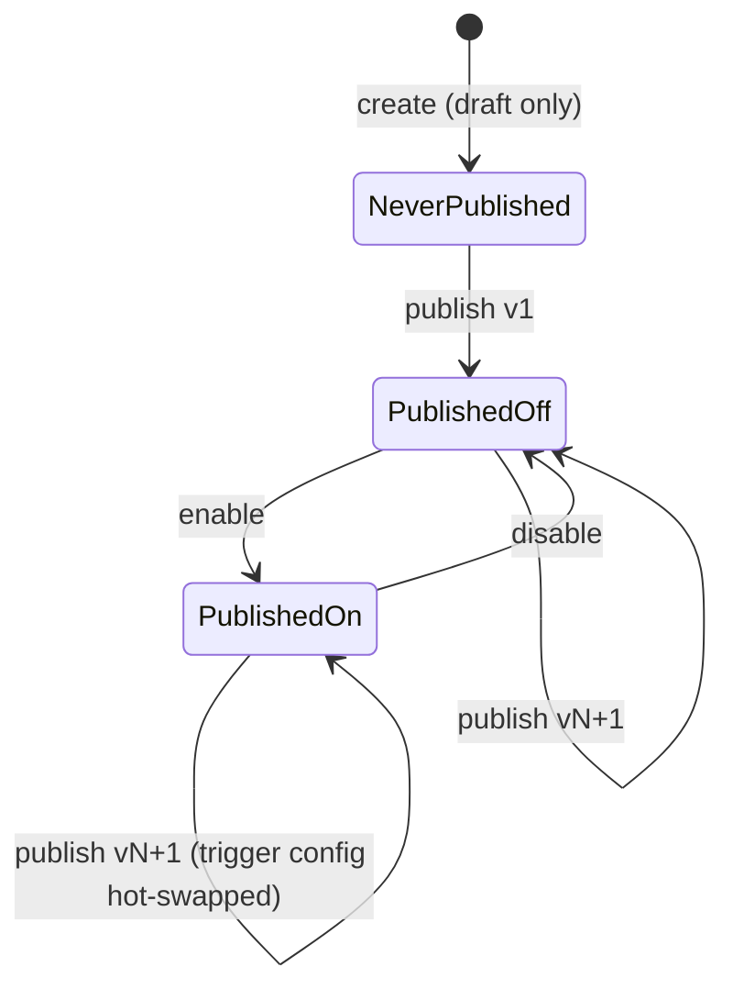
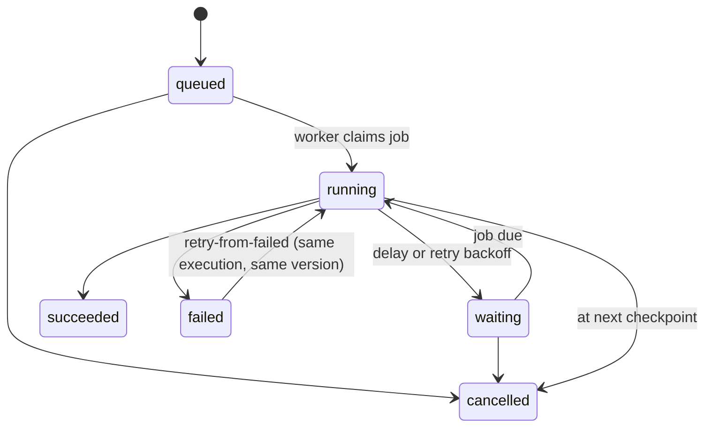

# 04: Workflow engine

This is the core of the product. It is designed as a **functional core** (`weft-engine` and `weft-expr`: pure, deterministic, property-testable) inside an **imperative shell** (`weft-app::runner` plus `weft-worker`, which handle IO, persistence and timing).

---

## 1. Lifecycles

### 1.1 Flow
A flow always has a **draft**. It may also have a **published version** and an **enabled** flag.


- Editing the draft never affects running or future executions until the next **publish**.
- If the draft differs from the published version, the UI shows an "Unpublished changes" badge.

### 1.2 Execution


### 1.3 Step run (one row per attempt)
`running → succeeded | failed | retry_scheduled | skipped`, plus `unknown_outcome`, which marks a crash between the external call and the checkpoint (see §8).

---

## 2. Flow definition (v1)

The definition is a JSON document with a JSON Schema generated by `schemars`. The draft and all published versions are stored as JSON. Canonical examples live in `fixtures/flows/*.json` and are shared with the Dart tests.

```json
{
  "schema_version": 1,
  "trigger": { "type": "webhook", "config": { "split_array": true } },
  "steps": [
    {
      "key": "is_big_order",
      "name": "Is it a big order?",
      "type": "decision",
      "branches": [
        {
          "key": "big",
          "name": "Amount > 100",
          "condition": { "all": [ { "left": "{{ trigger.body.amount }}", "op": "gt", "right": 100 } ] },
          "steps": [
            {
              "key": "notify_sales",
              "type": "action",
              "connector": "slack",
              "action": "post_message",
              "connection_id": "cxn_01JD3Q8T6C2V7W9X0Y1Z2A3B4C",
              "input": { "channel": "C0123", "text": "Big order from {{ trigger.body.email }}: {{ trigger.body.amount }}" }
            }
          ]
        }
      ],
      "otherwise": [
        { "key": "pretty_name", "type": "action", "connector": "core.formatter", "action": "text_title_case",
          "input": { "text": "{{ trigger.body.name }}" } },
        { "key": "thank_customer", "type": "action", "connector": "core.email", "action": "send",
          "input": { "to": "{{ trigger.body.email }}", "subject": "Thanks, {{ steps.pretty_name.result }}!", "body": "We got your order." } }
      ]
    },
    { "key": "wait_a_day", "type": "delay", "mode": "for", "duration": "P1D" },
    { "key": "ask_review", "type": "action", "connector": "core.http", "action": "request",
      "input": { "method": "POST", "url": "https://reviews.example.com/api/requests", "json": { "email": "{{ trigger.body.email }}" } },
      "retry": { "max_attempts": 5 }, "on_error": "continue" }
  ]
}
```

### 2.1 Rust model (`weft-domain/src/flow/definition.rs`)
```rust
#[derive(Debug, Clone, PartialEq, Serialize, Deserialize, JsonSchema)]
pub struct FlowDefinition {
    pub schema_version: u16,
    pub trigger: TriggerNode,
    pub steps: Vec<Step>,
}

#[derive(Debug, Clone, PartialEq, Serialize, Deserialize, JsonSchema)]
pub struct Step {
    pub key: StepKey,                    // [a-z][a-z0-9_]{0,63}, unique within the flow
    #[serde(default)] pub name: Option<String>,
    #[serde(flatten)] pub kind: StepKind,
    #[serde(default)] pub on_error: OnError,           // fail_flow (default) | continue
    #[serde(default)] pub retry: Option<RetryOverride>,
    #[serde(default)] pub sample_output: Option<serde_json::Value>, // builder only; ignored by engine
}

#[derive(Debug, Clone, PartialEq, Serialize, Deserialize, JsonSchema)]
#[serde(tag = "type", rename_all = "snake_case")]
pub enum StepKind {
    Action(ActionStep),          // connector + action + connection + input templates
    Decision(DecisionStep),      // branches[{key, condition, steps}] + otherwise[]
    Delay(DelayStep),            // mode: for(duration) | until(template datetime)
    SetVariable(SetVariableStep),// assignments[{name, value template}]
    Stop(StopStep),              // status: succeeded | failed, message
    // P2+: Loop(LoopStep), Script(ScriptStep); P3: CallSubflow(CallSubflowStep), Respond(RespondStep)
}

#[derive(Debug, Clone, PartialEq, Serialize, Deserialize, JsonSchema)]
#[serde(tag = "type", rename_all = "snake_case")]
pub enum TriggerNode {
    Webhook { config: WebhookTriggerConfig },
    Schedule { config: ScheduleSpec },
    App { connector: ConnectorKey, trigger: String, connection_id: Option<ConnectionId>, input: InputMap }, // P2
    Manual,
}
```
**If-else** is a `Decision` with one branch plus `otherwise`. The UI renders it with true/false labels using a `"ui": "if_else"` hint.

### 2.2 Validation (`validate_for_publish`, pure)
A draft may be saved while invalid. **Publishing requires zero errors.** Each issue carries a JSON Pointer so the builder can highlight the exact field:
```json
{ "severity": "error", "path": "/steps/0/branches/0/steps/0/input/channel", "code": "field.required", "message": "Channel is required" }
```
Rules:
- The trigger is configured.
- Step keys are unique and well-formed.
- Every action's connector and action exist in the catalog.
- A connection is set when the connector needs auth, and it belongs to the org and to that connector.
- Required fields are present.
- Every template parses.
- **Variable scope analysis**: `steps.X` must be a step that is guaranteed to run before this one on every path to it. A reference into a sibling branch is an error; a reference into a step that may have been skipped by `on_error: continue` is a warning.
- A decision has at least one branch.
- Delay bounds hold, and the limits from doc 01 §4 hold.

### 2.3 Schema evolution
- `schema_version` is bumped on any breaking change. `weft-domain::flow::upcast(raw: Value) -> Result<FlowDefinition>` chains `v1→v2→…` in memory.
- Stored versions are **never rewritten**.
- Every historical fixture (`fixtures/flows/v1/*.json`) is kept forever, and a test asserts that each one still upcasts and compiles.

---

## 3. Expressions and data mapping (`weft-expr`)

### 3.1 Scope available to templates
| Variable | Contents |
|---|---|
| `trigger` | Trigger output. Webhook: `{method, headers, query, body, received_at}`. Schedule: `{scheduled_for, fired_at}`. App: the item. |
| `steps.<key>` | Output of an earlier step, e.g. `steps.notify_sales.ts` |
| `vars.<name>` | Flow variables set by `set_variable` |
| `flow` | `{id, name, version}` |
| `execution` | `{id, started_at, mode}` |
| `loop` (P2) | `{item, index, first, last}` |
| `org_vars` (P3) | Org-level constants, e.g. a base URL |

### 3.2 Semantics
1. **Typed passthrough:** if a string field is *exactly* one expression (`"{{ steps.fetch.rows }}"`), the result is the **JSON value** itself, so arrays, numbers and objects keep their types.
2. Otherwise the string is **rendered** to text (`"Hi {{ trigger.body.name }}"`).
3. Objects and arrays in `input` are rendered **recursively** at their string leaves.
4. **Undefined** values render as `null` in typed mode and `""` in text mode (lenient, like Zoho). The step run records a `warnings[]` entry. Fields can opt into `strict`, which fails with `mapping.undefined_variable`.
5. **Sandbox:** minijinja with no includes or imports, only our filters and globals, **fuel** (instruction budget), a recursion limit and an output size limit.

### 3.3 Filters (MVP set; each is a pure, tested function)
| Group | Filters |
|---|---|
| Text | `upper lower title trim replace(a,b) truncate(n) slugify split(sep) join(sep) regex_replace(p,r) default(v) length` |
| Number | `round(n) abs int float format_number(decimals, sep)` |
| Date | `date(fmt, tz)` `date_add("P1D")` `date_diff(other, unit)` `to_timestamp`, plus the global `now()` (bound from `execution.started_at` so it stays deterministic) |
| Data | `json` (to string) `from_json` `first last` `pluck(key)` `keys values` `get(path)` |
| Encoding | `url_encode base64_encode base64_decode sha256 hmac_sha256(key)` |

### 3.4 Conditions (decision branches; P2 trigger filters)
A JSON tree that the client builds visually, with no code evaluation:
```json
{ "any": [
  { "all": [
    { "left": "{{ trigger.body.amount }}",  "op": "gt", "right": 100 },
    { "left": "{{ trigger.body.country }}", "op": "in", "right": ["IN", "US"] }
  ]},
  { "left": "{{ trigger.body.vip }}", "op": "is_true" }
]}
```
- **Operators:** `eq neq gt gte lt lte contains not_contains starts_with ends_with in not_in is_empty is_not_empty is_true is_false matches_regex date_before date_after date_on exists not_exists`.
- An optional `"case_insensitive": true` applies to text operators.
- **Coercion:** numeric comparison applies when both sides parse as numbers, date comparison when both parse as dates; otherwise values are compared as strings.
- **A type or evaluation error makes the leaf evaluate to `false`** and adds a warning to the trace, so a decision never crashes a run.

---

## 4. Compilation to a Plan (IR)

The tree-shaped definition is compiled into a flat **instruction list**. Resuming a run then only needs a **program counter** plus a small stack, which is trivial to serialize, persist and property-test. Every instruction carries its `StepKey` so traces map back to the builder.

```rust
pub struct Plan { pub instrs: Vec<Instr>, pub index: HashMap<StepKey, Pc> }

pub enum Instr {
    Action  { step: StepKey },
    Branch  { step: StepKey, arms: Vec<Arm>, otherwise: Pc },  // Arm { branch: BranchKey, condition: Condition, target: Pc }
    Jump    { target: Pc },
    Delay   { step: StepKey },
    SetVar  { step: StepKey },
    Stop    { step: StepKey },
    // P2: LoopEnter { step, exit: Pc }, LoopNext { enter: Pc }
    End,
}
```

The example flow from §2 compiles to the following. `Plan` implements `Display`, and this text is what the snapshot tests store:
```
0  BRANCH  is_big_order  big→1  otherwise→3
1  ACTION  notify_sales
2  JUMP    6
3  ACTION  pretty_name
4  ACTION  thank_customer
5  JUMP    6
6  DELAY   wait_a_day
7  ACTION  ask_review
8  END
```
Compilation is total for any definition that passed validation: `compile(&FlowDefinition) -> Result<Plan, CompileError>`. Plans are cached in the worker (an LRU keyed by the immutable `flow_version_id`).

---

## 5. The interpreter (pure)

```rust
/// Read-only facts the interpreter may look at. No IO, no clock calls: `now` is passed in.
pub struct Facts<'a> {
    pub trigger: &'a Value,
    pub outputs: &'a StepOutputs,      // StepKey (+ iteration) → latest successful output
    pub meta: &'a ExecutionMeta,       // flow id/name/version, execution id/mode/started_at
    pub now: Timestamp,
}

#[derive(Clone, Serialize, Deserialize)]
pub struct RunState {
    pub pc: Pc,
    pub vars: Map<String, Value>,
    pub wait: Option<Wait>,            // { step, until }: set while sleeping
    pub attempts: HashMap<StepKey, u16>,
    pub loop_stack: Vec<LoopFrame>,    // P2
    pub instructions_executed: u32,    // guard against runaway execution
}

pub enum Directive {
    RunAction { step: StepKey, attempt: u16, input: Value },  // input already rendered
    Sleep     { step: StepKey, until: Timestamp },
    Finish    (Outcome),                                       // Succeeded | Failed{code,msg,step} | Stopped
}

pub struct Advance { pub state: RunState, pub directive: Directive, pub trace: Vec<TraceEntry> }

/// Runs control-flow instructions (branch, jump, set var, finished delays) until it reaches
/// something that needs the outside world. Pure; same inputs give the same output.
pub fn advance(plan: &Plan, def: &FlowDefinition, state: RunState, facts: &Facts) -> Result<Advance, EngineError>;

pub enum StepResult { Succeeded { output: Value }, Failed(StepError) }   // StepError { code, message, retryable, retry_after }
pub enum AfterResult { Continue, RetryAt(Timestamp), FailExecution(StepError) }

/// Applies the result of a RunAction. Decides retry/continue/fail from the retry policy. Pure.
pub fn record_result(plan: &Plan, def: &FlowDefinition, state: RunState, step: &StepKey,
                     result: &StepResult, now: Timestamp) -> Result<(RunState, AfterResult), EngineError>;
```
`TraceEntry` records the decisions taken (which arm matched and why), variables set, delays scheduled and warnings. The runner persists these as step runs, so the history shows logic steps as well as actions.

**Invariants** (all checked by property tests in doc 09):
- I1 Termination: `advance` returns within `max_instructions`.
- I2 Determinism: the same `(plan, state, facts)` always gives the same `Advance`.
- I3 Resume equivalence: persisting and reloading `RunState` at any checkpoint does not change the eventual outcome or the sequence of actions.
- I4 Exactly one directive per advance; actions are emitted in program order along the taken path.
- I5 A step that has succeeded is never emitted again in the same iteration.

---

## 6. The runner (imperative shell, `weft-app::runner::run_slice`)

```text
run_slice(execution_id, budget):
  exe  = executions.load_for_run(execution_id)          // state, version id, trigger payload, outputs
  if exe.terminal() or exe.cancel_requested: finalize; return Done
  plan = plan_cache.get_or_compile(exe.version)
  loop:
    if budget exhausted (time slice e.g. 60 s or N steps): return RescheduleAt(now)   // fairness
    adv = engine::advance(plan, def, exe.state, facts(exe, clock.now()))
    persist adv.trace as step_runs                        // decisions, set vars
    match adv.directive:
      RunAction{step, attempt, input}:
        quota.check(org)?                                 // QuotaExceeded → fail execution
        sr = executions.start_step(exe, step, attempt, input)          // status=running (before the call!)
        res = timeout(action_timeout, connectors.run(step, ctx{connection, idempotency_key}, input))
        (state, after) = engine::record_result(plan, def, adv.state, step, res, clock.now())
        executions.finish_step(sr, res, state)            // one txn: step_run + run_state (+ usage +1)
        match after:
          Continue          → continue loop
          RetryAt(t)        → executions.mark_waiting(exe, t); return RescheduleAt(t)
          FailExecution(e)  → executions.finish(exe, Failed(e)); notify; return Done
      Sleep{until}       → executions.save_waiting(exe, adv.state, until); return RescheduleAt(until)
      Finish(outcome)    → executions.finish(exe, outcome); if failed: notify; return Done
```
The worker turns `RescheduleAt(t)` into `UPDATE jobs SET run_at = t, status = 'ready'`, and turns `Done` into `DELETE FROM jobs`. If a worker crashes at *any* line, the job's lease expires and another worker resumes from the persisted `run_state`.

### What is persisted when
| Moment | Write (single transaction) |
|---|---|
| Trigger accepted | `trigger_events` + `executions(queued)` + `jobs(run_execution)` |
| Before an external call | `step_runs(running, input)` |
| After an external call | `step_runs(result)` + `executions.run_state` + `usage_counters` (on success) |
| Sleep / retry | `executions(waiting, run_state)`; the job is rescheduled |
| Finish | `executions(final status, finished_at)`; the job is deleted; a notification job is added if the run failed |

---

## 7. Triggers

### 7.1 Webhook (MVP)
- URL: `https://hooks.<domain>/hooks/{token}`. The token is 32 random bytes in base64url (43 chars). It is created with the draft, so the user can paste it into the source app before publishing. A separate subdomain allows its own rate limits and WAF rules.
- Methods: POST, PUT and PATCH, plus GET (query string only).
- Bodies: JSON, `x-www-form-urlencoded` and `text/plain`; XML in P2; multipart files in P3. Size limit is 5 MB.
- The normalized trigger output is `{ method, headers, query, body, received_at }`. Header names are lowercased. `authorization` and `cookie` are dropped unless the flow opts in.
- **Array split:** a JSON array body with `split_array: true` becomes N executions, capped at 100.
- **Idempotency:** a configurable header (default `Idempotency-Key`) becomes the `dedupe_key`, and a repeat returns the original response.
- Responses:
  - `202 {status:"accepted", executions:[…]}`
  - flow off: `202 {status:"ignored"}`, logged as an ignored event visible in history
  - unknown token: `404`
  - body too large: `413`
  - rate limited: `429`
- **Listening mode** (builder sample capture): while `listening_until > now`, the payload is stored as the draft's trigger sample. If the flow is on, it is also executed.
- **Durability:** a 2xx is sent only after the transaction commits.

### 7.2 Schedule (MVP)
- `ScheduleSpec` forms (all with an IANA time zone):
  - `once{at}`
  - `recurring{every: minutes|hours|day|week|month|year, interval, at_time, days_of_week, day_of_month}`
  - `cron{expr}`
- The domain method `fn next_after(&self, t: Timestamp) -> Option<Timestamp>` is **pure** and heavily tested, including DST gaps and overlaps, the 31st of short months, and leap years.
- **Scheduler loop** (every worker, about every 1 s):
  ```sql
  SELECT id FROM trigger_registrations
   WHERE kind = 'schedule' AND is_active = TRUE AND next_fire_at <= ?   -- ? = clock.now()
   ORDER BY next_fire_at LIMIT 100 FOR UPDATE SKIP LOCKED;
  ```
  For each due registration, one transaction inserts a `trigger_event` with `dedupe_key = scheduled slot`, then an execution, then a job, and advances `next_fire_at`. The unique `(registration_id, dedupe_key)` key guarantees **exactly one execution per slot**, even if two schedulers race.
- **Misfire policy:** after downtime, fire **once** for the latest missed slot and skip older ones. The skipped slots are logged.

### 7.3 Polling app triggers (P2)
- The registration has `next_fire_at`. When it is due, the scheduler enqueues a `poll_trigger` job (dedupe `poll:{registration}`).
- The connector contract: `poll(ctx, state) -> PollResult { items: Vec<{ dedupe_key, data }>, state }`.
- **The first poll is a baseline**: it records the cursor and seen keys without firing, so connecting a sheet with 10k rows does not create 10k runs. The user can opt into "process existing items".
- Items are processed oldest first, at most 100 per poll. A new item becomes a `trigger_event` (insert-if-absent on the dedupe key), then an execution, then a job.
- On repeated `AuthExpired`, the connection is marked `needs_reauth`, the owner is notified, and polling pauses.

### 7.4 Instant app triggers (P2)
- On enable, the connector calls `subscribe(ctx, target_url)`, and the external subscription ID is stored in `state`. On disable or delete, an `unsubscribe` job runs with retries.
- Incoming requests go through `connector.verify(request)` (HMAC, signing secret, or a challenge handshake) and then `connector.parse_event(request) -> Vec<item>`. After that the path is the same as a webhook.

### 7.5 Manual and test runs (MVP)
- `POST /flows/{id}/run {payload}` runs the **published** version with `mode = manual`.
- `POST /flows/{id}/test {payload}` snapshots the **draft** into a `flow_versions` row with `kind = 'test_snapshot'`, so every execution still pins a version and there is one code path. It runs with `mode = test` on the high-priority `executions_test` queue. Test snapshots are garbage-collected after 7 days.
- `POST /flows/{id}/steps/{key}/test` is **synchronous**: it renders the step's inputs against the sample context, calls the action (30 s timeout), returns `{input, output | error}`, and stores the output as that step's `sample_output` in the draft. It does not count as a task in the MVP.

---

## 8. Job queue (MySQL, `weft-db::job_queue`)

| Job kind | Queue | Dedupe key | Payload |
|---|---|---|---|
| `run_execution` | `executions` | `exe:{id}` | `{execution_id}` |
| `run_execution` (test mode) | `executions_test` | `exe:{id}` | `{execution_id}` |
| `send_notification` | `notifications` | — | `{kind, execution_id}` |
| `retention_sweep` | `maintenance` | `retention:{date}` | `{}` |
| `poll_trigger` (P2) | `triggers` | `poll:{registration_id}` | `{registration_id}` |
| `subscribe_trigger` / `unsubscribe_trigger` (P2) | `triggers` | `sub:{registration_id}` | `{registration_id}` |
| `refresh_connection` (P2) | `maintenance` | `refresh:{connection_id}` | `{connection_id}` |

**Claim** (one transaction; `?now` is always bound from `Clock`):
```sql
SELECT id FROM jobs
 WHERE queue = ? AND status = 'ready' AND run_at <= ?
 ORDER BY run_at
 LIMIT ?
 FOR UPDATE SKIP LOCKED;

UPDATE jobs
   SET status = 'running', locked_by = ?, locked_until = ?, attempts = attempts + 1, updated_at = ?
 WHERE id IN (…);
```
- **Lease and heartbeat:** `locked_until = now + 60 s`, extended every 20 s while the handler runs.
- **Reaper:** `UPDATE jobs SET status = 'ready' WHERE status = 'running' AND locked_until < ?`.
- **Poison jobs:** a job whose `attempts` exceeds `max_attempts` (25) without completing becomes `dead`, and its execution fails with `internal.poison_job` and alerts.
- **Completion:** `Done` deletes the row, which keeps the hot table small. History lives in `executions`.
- **Wake-ups:** each queue loop polls every 200 ms, backing off to 1 s when idle. In `weft all` mode an in-process `Notify` wakes the loop immediately after an enqueue.
- **Concurrency:** a semaphore per queue (e.g. 32 for `executions`). P3 adds per-org concurrency caps and fair scheduling.

---

## 9. Errors, retries and reruns

### 9.1 Error taxonomy (from connectors and the runtime)
| Class | Examples | Auto-retry? | Execution result if it is the final failure |
|---|---|---|---|
| `Transient` | Network error, timeout, HTTP 5xx, 408 | Yes | failed (`app.unavailable`) |
| `RateLimited{retry_after}` | HTTP 429 | Yes, honouring `Retry-After` (capped at 6 h) | failed (`app.rate_limited`) |
| `AuthExpired` | 401 / invalid token | Refresh once and retry immediately; then no | failed (`connection.needs_reauth`); connection flagged |
| `InvalidInput{field}` | 400/422 from the app, or a mapping produced an invalid value | **No** (configuration or mapping error, as in Zoho) | failed (`app.invalid_input`) |
| `NotFound` / `Permanent` | 404, 403, other 4xx | No | failed |
| `Internal` | Our bug or a DB failure | Yes (the job-level retry) | failed (`internal.error`) |

### 9.2 Default retry policy (overridable per step)
- Up to **8 retries**, waiting `1m, 5m, 15m, 30m, 1h, 2h, 4h, 6h` with ±10% jitter. This mirrors Zoho's "up to 8 times, from 5 min to 6 h".
- While waiting, the execution is `waiting`; the history shows "Retry 3/8 scheduled at …".
- A request that was **never sent** (DNS or connection refused) may be retried immediately once at the HTTP layer.

### 9.3 Rerun semantics
| Operation | Version used | Starts at | Execution record | Typical use |
|---|---|---|---|---|
| **Retry from failed step** | Same (pinned) | The failed step; earlier outputs reused | Same execution | The account was reconnected, or the app is back up |
| **Re-run** | Latest published | The beginning, with the same trigger payload | New execution (`rerun_of`) | The flow's mapping or configuration was fixed |
| **Bulk re-run** (P2) | Latest published | The beginning | New executions (≤ 100 per request) | Recovering from an incident |
| **Cancel** | — | — | `cancel_requested_at` is set; a waiting run is cancelled immediately, a running one at its next checkpoint | |

---

## 10. Delivery guarantees (documented to users)

| Stage | Guarantee | Mechanism |
|---|---|---|
| Webhook accepted (2xx) | An execution exists | Same transaction as the 2xx decision |
| Schedule slot | Exactly one execution per slot | Unique `(registration_id, dedupe_key)` |
| Poll item | At most one execution per item key | Unique dedupe key |
| Action call | **At least once** | A checkpoint after every call. If the process crashes after the app responds but before the commit, the call is repeated. |

Mitigations for the at-least-once window:
- Every `ActionCtx` carries `idempotency_key = sha256(execution_id ‖ step_key ‖ iteration)`. Connectors forward it where the app supports it (e.g. Stripe's `Idempotency-Key`).
- On resume, a step run still `running` with no result becomes `unknown_outcome`. Connectors declare `idempotent: true|false` per action:
  - idempotent actions are re-executed;
  - non-idempotent actions are re-executed **with a "possible duplicate" badge** in history by default. A per-flow setting can choose "fail instead".

Ordering between executions of the same flow is **not** guaranteed (they run in parallel). P3 adds a per-flow option `concurrency: 1` for order-sensitive flows.

---

## 11. Usage accounting
- **Task = one executed action attempt that reached the app** (success or non-retried failure). Logic steps, test-step calls and automatic retries are free in the MVP; this is a product decision, so revisit it with pricing.
- Usage is recorded in the same transaction as the step result: `INSERT … ON DUPLICATE KEY UPDATE tasks_used = tasks_used + 1` on `usage_counters(org_id, period)`. P3 moves this to batched in-memory counters if that row becomes a hotspot.
- Quota check: hitting the limit fails new executions with `usage.quota_exceeded`, and the org owner is notified at 80% and 100%.
