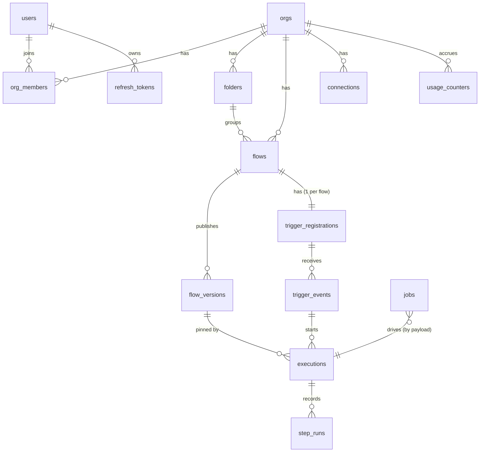

# 05: Data model (MySQL 8.4 LTS)

## 1. Conventions

| Topic | Rule | Why |
|---|---|---|
| Engine and charset | InnoDB, `utf8mb4`, `utf8mb4_0900_ai_ci`, set at the database level | Emoji-safe; one collation everywhere |
| Primary keys | `id BINARY(16)` holding a UUIDv7 generated in Rust | Time-ordered inserts keep the clustered index compact; no `AUTO_INCREMENT` coupling |
| Tenancy | **Every tenant-owned table has `org_id`**, and every query filters on it | Isolation; see doc 08 |
| Timestamps | `DATETIME(6)` in **UTC**, always bound from the `Clock` port; `created_at` and `updated_at` everywhere | Deterministic tests; microsecond round-trip |
| Enumerations | `VARCHAR(16..32)` with snake_case values, mapped to Rust enums (the single source of truth) | Adding a variant needs no `ALTER TABLE`; readable in SQL |
| JSON | `JSON` columns for definitions, payloads, step input/output and config | Validated by MySQL; never queried in hot paths |
| Booleans | `BOOLEAN` (`TINYINT(1)`) | — |
| Foreign keys | **Yes** on low-volume configuration tables; **no** on high-volume tables (`executions`, `step_runs`, `trigger_events`, `jobs`) | MySQL cannot partition tables that have FKs, and FKs add lock contention on hot inserts |
| Soft delete | Only on `flows` and `connections` (`deleted_at`); everything else is a hard delete | Simpler queries |
| Naming | Plural snake_case tables; `ix_<table>_<cols>`, `uq_<table>_<cols>`, `fk_<table>_<ref>` | Predictable for agents |
| SQL style | No `SELECT *`, no `NOW()`, explicit column lists, `?` binds, all SQL inside `weft-db` | Enforced by `xtask check-sql` |

---

## 2. Entity relationship overview



---

## 3. DDL (Phase 1)

Each block below is its own migration file, named `YYYYMMDDHHMMSS_<name>.sql`.

### 3.1 Identity
> **Superseded for the MVP by doc 13 §7.** Logto owns credentials, so `users` becomes `logto_subject`-based, `invitations` is added, and `refresh_tokens` and `user_tokens` are dropped. `orgs` and `org_members` below still apply. The sync tables (`record_links`, `sync_leases`, `app_subscriptions`, `backfills`, `connection_usage`) are also defined in doc 13 §7.

```sql
CREATE TABLE users (
  id                BINARY(16)   NOT NULL,
  email             VARCHAR(320) NOT NULL,              -- stored lowercase
  display_name      VARCHAR(120) NOT NULL,
  password_hash     VARCHAR(255) NULL,                  -- argon2id PHC string; NULL for SSO-only (P3)
  email_verified_at DATETIME(6)  NULL,
  created_at        DATETIME(6)  NOT NULL,
  updated_at        DATETIME(6)  NOT NULL,
  PRIMARY KEY (id),
  UNIQUE KEY uq_users_email (email)
);

CREATE TABLE orgs (
  id          BINARY(16)   NOT NULL,
  name        VARCHAR(120) NOT NULL,
  plan        VARCHAR(32)  NOT NULL DEFAULT 'free',
  timezone    VARCHAR(64)  NOT NULL DEFAULT 'UTC',
  created_at  DATETIME(6)  NOT NULL,
  updated_at  DATETIME(6)  NOT NULL,
  PRIMARY KEY (id)
);

CREATE TABLE org_members (
  org_id     BINARY(16)  NOT NULL,
  user_id    BINARY(16)  NOT NULL,
  role       VARCHAR(16) NOT NULL,                      -- owner | admin | member | viewer
  created_at DATETIME(6) NOT NULL,
  PRIMARY KEY (org_id, user_id),
  KEY ix_org_members_user (user_id),
  CONSTRAINT fk_org_members_org  FOREIGN KEY (org_id)  REFERENCES orgs(id),
  CONSTRAINT fk_org_members_user FOREIGN KEY (user_id) REFERENCES users(id)
);

CREATE TABLE refresh_tokens (
  id          BINARY(16)  NOT NULL,
  user_id     BINARY(16)  NOT NULL,
  family_id   BINARY(16)  NOT NULL,                     -- rotation chain; reuse ⇒ revoke family
  token_hash  BINARY(32)  NOT NULL,                     -- SHA-256 of the opaque token
  expires_at  DATETIME(6) NOT NULL,
  rotated_at  DATETIME(6) NULL,
  revoked_at  DATETIME(6) NULL,
  created_at  DATETIME(6) NOT NULL,
  PRIMARY KEY (id),
  UNIQUE KEY uq_refresh_tokens_hash (token_hash),
  KEY ix_refresh_tokens_family (family_id),
  CONSTRAINT fk_refresh_tokens_user FOREIGN KEY (user_id) REFERENCES users(id)
);

CREATE TABLE user_tokens (                               -- email verification, password reset
  token_hash  BINARY(32)  NOT NULL,
  user_id     BINARY(16)  NOT NULL,
  purpose     VARCHAR(32) NOT NULL,                     -- verify_email | reset_password
  expires_at  DATETIME(6) NOT NULL,
  used_at     DATETIME(6) NULL,
  created_at  DATETIME(6) NOT NULL,
  PRIMARY KEY (token_hash),
  KEY ix_user_tokens_user (user_id, purpose),
  CONSTRAINT fk_user_tokens_user FOREIGN KEY (user_id) REFERENCES users(id)
);
```

### 3.2 Flows
```sql
CREATE TABLE folders (
  id          BINARY(16)   NOT NULL,
  org_id      BINARY(16)   NOT NULL,
  name        VARCHAR(120) NOT NULL,
  created_at  DATETIME(6)  NOT NULL,
  updated_at  DATETIME(6)  NOT NULL,
  PRIMARY KEY (id),
  UNIQUE KEY uq_folders_org_name (org_id, name),
  CONSTRAINT fk_folders_org FOREIGN KEY (org_id) REFERENCES orgs(id)
);

CREATE TABLE flows (
  id                   BINARY(16)   NOT NULL,
  org_id               BINARY(16)   NOT NULL,
  folder_id            BINARY(16)   NULL,
  name                 VARCHAR(200) NOT NULL,
  description          TEXT         NULL,
  is_enabled           BOOLEAN      NOT NULL DEFAULT FALSE,
  draft_definition     JSON         NOT NULL,
  draft_revision       INT UNSIGNED NOT NULL DEFAULT 1,   -- optimistic concurrency (ETag/If-Match)
  published_version_id BINARY(16)   NULL,
  created_by           BINARY(16)   NOT NULL,
  created_at           DATETIME(6)  NOT NULL,
  updated_at           DATETIME(6)  NOT NULL,
  deleted_at           DATETIME(6)  NULL,
  PRIMARY KEY (id),
  KEY ix_flows_org_updated (org_id, deleted_at, updated_at),
  KEY ix_flows_folder (folder_id),
  CONSTRAINT fk_flows_org    FOREIGN KEY (org_id)    REFERENCES orgs(id),
  CONSTRAINT fk_flows_folder FOREIGN KEY (folder_id) REFERENCES folders(id) ON DELETE SET NULL
);

CREATE TABLE flow_versions (
  id           BINARY(16)   NOT NULL,
  org_id       BINARY(16)   NOT NULL,
  flow_id      BINARY(16)   NOT NULL,
  kind         VARCHAR(16)  NOT NULL DEFAULT 'published', -- published | test_snapshot
  version      INT UNSIGNED NULL,                         -- 1,2,3… for published; NULL for test snapshots
  definition   JSON         NOT NULL,                     -- immutable
  created_by   BINARY(16)   NOT NULL,
  created_at   DATETIME(6)  NOT NULL,
  PRIMARY KEY (id),
  UNIQUE KEY uq_flow_versions_number (flow_id, version),   -- NULLs don't collide in MySQL
  KEY ix_flow_versions_kind (kind, created_at),            -- GC of test snapshots
  CONSTRAINT fk_flow_versions_flow FOREIGN KEY (flow_id) REFERENCES flows(id)
);
```

### 3.3 Connections
```sql
CREATE TABLE connections (
  id                BINARY(16)       NOT NULL,
  org_id            BINARY(16)       NOT NULL,
  connector_key     VARCHAR(64)      NOT NULL,
  name              VARCHAR(200)     NOT NULL,
  auth_kind         VARCHAR(32)      NOT NULL,            -- none | api_key | basic | bearer | oauth2 | custom
  secret_ciphertext VARBINARY(16384) NOT NULL,            -- nonce ‖ AES-256-GCM ciphertext ‖ tag
  secret_key_id     VARCHAR(32)      NOT NULL,            -- master key used (rotation)
  display_meta      JSON             NULL,                -- non-secret: account email, workspace name
  status            VARCHAR(16)      NOT NULL,            -- active | needs_reauth | error
  token_expires_at  DATETIME(6)      NULL,
  created_by        BINARY(16)       NOT NULL,
  created_at        DATETIME(6)      NOT NULL,
  updated_at        DATETIME(6)      NOT NULL,
  deleted_at        DATETIME(6)      NULL,
  PRIMARY KEY (id),
  KEY ix_connections_org (org_id, connector_key, deleted_at),
  CONSTRAINT fk_connections_org FOREIGN KEY (org_id) REFERENCES orgs(id)
);

CREATE TABLE oauth_states (
  state_hash           BINARY(32)     NOT NULL,           -- SHA-256 of the random state
  org_id               BINARY(16)     NOT NULL,
  user_id              BINARY(16)     NOT NULL,
  connector_key        VARCHAR(64)    NOT NULL,
  connection_id        BINARY(16)     NULL,               -- set when re-authorizing an existing connection
  connection_name      VARCHAR(200)   NOT NULL,
  pkce_verifier_cipher VARBINARY(512) NOT NULL,
  return_to            VARCHAR(2048)  NOT NULL,           -- validated against allowed client origins
  expires_at           DATETIME(6)    NOT NULL,
  created_at           DATETIME(6)    NOT NULL,
  PRIMARY KEY (state_hash),
  KEY ix_oauth_states_expiry (expires_at)
);
```

### 3.4 Triggers
```sql
CREATE TABLE trigger_registrations (
  id              BINARY(16)  NOT NULL,
  org_id          BINARY(16)  NOT NULL,
  flow_id         BINARY(16)  NOT NULL,
  kind            VARCHAR(16) NOT NULL,                   -- webhook | schedule | poll | instant | manual
  webhook_token   CHAR(43)    NULL,                       -- base64url(32 bytes), for webhook/instant
  is_active       BOOLEAN     NOT NULL DEFAULT FALSE,     -- mirrors flows.is_enabled
  listening_until DATETIME(6) NULL,                       -- builder sample capture
  next_fire_at    DATETIME(6) NULL,                       -- schedule & poll
  config          JSON        NOT NULL,                   -- ScheduleSpec / webhook options / app trigger
  state           JSON        NULL,                       -- poll cursor, external subscription id
  connection_id   BINARY(16)  NULL,
  sample_payload  JSON        NULL,                       -- last captured sample (builder)
  created_at      DATETIME(6) NOT NULL,
  updated_at      DATETIME(6) NOT NULL,
  PRIMARY KEY (id),
  UNIQUE KEY uq_trigger_registrations_token (webhook_token),
  UNIQUE KEY uq_trigger_registrations_flow (flow_id),     -- one trigger per flow
  KEY ix_trigger_registrations_due (kind, is_active, next_fire_at),
  CONSTRAINT fk_trigger_registrations_flow FOREIGN KEY (flow_id) REFERENCES flows(id)
);

CREATE TABLE trigger_events (                                -- high volume: no FKs
  id              BINARY(16)   NOT NULL,
  org_id          BINARY(16)   NOT NULL,
  flow_id         BINARY(16)   NOT NULL,
  registration_id BINARY(16)   NOT NULL,
  dedupe_key      VARCHAR(191) NULL,                       -- schedule slot / poll item / Idempotency-Key
  status          VARCHAR(16)  NOT NULL,                   -- accepted | ignored | sample
  payload         JSON         NOT NULL,
  received_at     DATETIME(6)  NOT NULL,
  PRIMARY KEY (id),
  UNIQUE KEY uq_trigger_events_dedupe (registration_id, dedupe_key),
  KEY ix_trigger_events_flow (org_id, flow_id, received_at)
);
```

### 3.5 Executions
```sql
CREATE TABLE executions (                                    -- high volume: no FKs
  id                  BINARY(16)    NOT NULL,
  org_id              BINARY(16)    NOT NULL,
  flow_id             BINARY(16)    NOT NULL,
  flow_version_id     BINARY(16)    NOT NULL,
  trigger_event_id    BINARY(16)    NULL,
  mode                VARCHAR(16)   NOT NULL,                -- live | test | manual | rerun
  rerun_of            BINARY(16)    NULL,
  status              VARCHAR(16)   NOT NULL,                -- queued | running | waiting | succeeded | failed | cancelled
  run_state           JSON          NOT NULL,                -- engine RunState
  waiting_until       DATETIME(6)   NULL,
  task_count          INT UNSIGNED  NOT NULL DEFAULT 0,
  error_code          VARCHAR(64)   NULL,
  error_message       VARCHAR(2000) NULL,
  failed_step_key     VARCHAR(64)   NULL,
  possible_duplicate  BOOLEAN       NOT NULL DEFAULT FALSE,  -- unknown_outcome was re-executed
  cancel_requested_at DATETIME(6)   NULL,
  queued_at           DATETIME(6)   NOT NULL,
  started_at          DATETIME(6)   NULL,
  finished_at         DATETIME(6)   NULL,
  updated_at          DATETIME(6)   NOT NULL,
  PRIMARY KEY (id),
  KEY ix_executions_flow       (org_id, flow_id, queued_at),
  KEY ix_executions_org_status (org_id, status, queued_at),
  KEY ix_executions_retention  (queued_at)
);

CREATE TABLE step_runs (                                     -- high volume: no FKs
  id            BINARY(16)        NOT NULL,
  org_id        BINARY(16)        NOT NULL,
  execution_id  BINARY(16)        NOT NULL,
  seq           INT UNSIGNED      NOT NULL,                  -- timeline order within the execution
  step_key      VARCHAR(64)       NOT NULL,
  iteration     VARCHAR(64)       NOT NULL DEFAULT '',       -- loop path, e.g. "3" or "3.1" (P2)
  attempt       SMALLINT UNSIGNED NOT NULL,
  kind          VARCHAR(16)       NOT NULL,                  -- action | decision | delay | set_variable | stop
  status        VARCHAR(20)       NOT NULL,                  -- running | succeeded | failed | retry_scheduled | skipped | unknown_outcome
  input         JSON              NULL,
  output        JSON              NULL,
  error         JSON              NULL,                      -- {code, message, class, http_status, details}
  warnings      JSON              NULL,
  started_at    DATETIME(6)       NOT NULL,
  finished_at   DATETIME(6)       NULL,
  PRIMARY KEY (id),
  UNIQUE KEY uq_step_runs_attempt (execution_id, step_key, iteration, attempt),
  KEY ix_step_runs_execution (execution_id, seq)
);
```

### 3.6 Queue and usage
```sql
CREATE TABLE jobs (
  id            BINARY(16)   NOT NULL,
  queue         VARCHAR(32)  NOT NULL,                       -- executions | executions_test | triggers | notifications | maintenance
  kind          VARCHAR(32)  NOT NULL,
  org_id        BINARY(16)   NULL,
  payload       JSON         NOT NULL,
  status        VARCHAR(16)  NOT NULL,                       -- ready | running | dead
  run_at        DATETIME(6)  NOT NULL,
  attempts      INT UNSIGNED NOT NULL DEFAULT 0,
  max_attempts  INT UNSIGNED NOT NULL DEFAULT 25,
  locked_by     VARCHAR(128) NULL,
  locked_until  DATETIME(6)  NULL,
  last_error    TEXT         NULL,
  dedupe_key    VARCHAR(191) NULL,
  created_at    DATETIME(6)  NOT NULL,
  updated_at    DATETIME(6)  NOT NULL,
  PRIMARY KEY (id),
  UNIQUE KEY uq_jobs_dedupe (dedupe_key),
  KEY ix_jobs_claim (queue, status, run_at),
  KEY ix_jobs_lease (status, locked_until)
);

CREATE TABLE usage_counters (
  org_id      BINARY(16)   NOT NULL,
  period      CHAR(7)      NOT NULL,                         -- 'YYYY-MM'
  tasks_used  INT UNSIGNED NOT NULL DEFAULT 0,
  executions  INT UNSIGNED NOT NULL DEFAULT 0,
  updated_at  DATETIME(6)  NOT NULL,
  PRIMARY KEY (org_id, period)
);
```

### 3.7 Later phases (outline only)
| Table | Phase | Purpose |
|---|---|---|
| `custom_connectors` (org_id, key, version, spec JSON, status) | P2 | User-defined declarative connectors |
| `trigger_seen_items` (registration_id, item_key, seen_at) | P2 | Poll deduplication when there is no cursor |
| `notifications` (user_id, kind, payload, read_at) | P2 | In-app notifications |
| `audit_logs` (org_id, actor, action, target_type, target_id, metadata, ip, created_at) | P3 | Audit trail |
| `api_keys` (org_id, name, prefix, hash, scopes, last_used_at) | P3 | Public API |
| `templates` (key, name, category, definition, required_connectors) | P3 | Templates gallery |
| `org_variables` (org_id, name, value, is_secret) | P3 | Org-level constants |
| `data_stores`, `data_store_rows` | P4 | Key-value tables for flows |
| `agents` (on-prem agent registrations) | P4 | On-prem connectivity |

---

## 4. Growth, retention and partitioning
- **Hot tables:** `jobs` stays small because completed jobs are deleted. `executions`, `step_runs` and `trigger_events` grow with traffic.
- **Retention (MVP):** a daily `retention_sweep` job deletes rows older than the plan's retention in batches (`DELETE … WHERE queued_at < ? ORDER BY queued_at LIMIT 5000`, looping), deleting step runs before their executions. Each batch is short, to avoid long locks and replication lag.
- **Size controls:** step input and output are capped at 1 MB. Larger payloads fail with `step.output_too_large` until object storage arrives (P3, an optional S3-compatible store behind a `BlobStore` port).
- **Partitioning (P3, by ADR):** MySQL requires the partition column in every unique key. When needed, migrate `executions`/`step_runs` to `PRIMARY KEY (id, queued_at)`, partitioned `BY RANGE (TO_DAYS(queued_at))` monthly, and drop old partitions instead of deleting rows. Having no FKs on these tables keeps that possible.
- **Read scaling (P3):** history list queries can go to a read replica through a separate `HistoryReadRepo` port.

## 5. Migration rules (for agents)
1. One logical change per file, named `YYYYMMDDHHMMSS_<verb>_<object>.sql`, e.g. `20261203101500_add_flows_folder_id.sql`.
2. **Forward-only and append-only.** Never edit a merged migration; sqlx validates checksums, and so does `xtask check-migrations`.
3. MySQL DDL is **not transactional**, so keep each file to statements that are safe to re-run, or to a single DDL statement. Never mix DDL with large data backfills; backfills are separate jobs.
4. Prefer online DDL (`ALGORITHM=INSTANT/INPLACE`) on big tables. Adding a column at the end is instant in 8.0+.
5. Renames happen in two steps (add the new column and dual-write, then drop the old one in a later release).
6. After any migration: `just db-reset && just gen` (regenerates `.sqlx/`) and update the **schema snapshot** (doc 09 §6.3).
